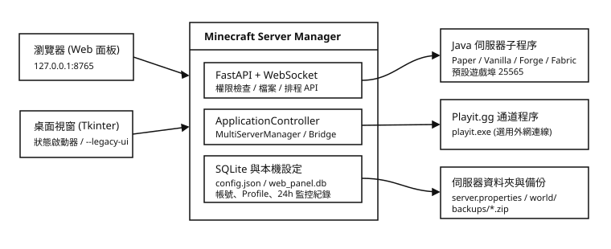
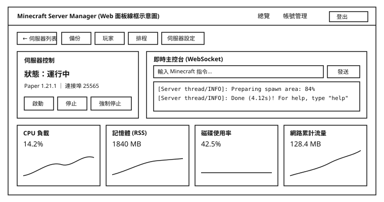

# Minecraft Server Manager

這是一個在 Windows 上跑的 Minecraft 伺服器圖形化管理工具，用 Python（Tkinter + FastAPI）寫成，結合了桌面啟動器與本機 Web 管理面板。

除了早期單伺服器的桌面操作介面外，目前版本預設會啟動一個監聽在 `127.0.0.1:8765` 的繁體中文 Web 管理面板，用來管理多台伺服器 Profile、即時主控台、檔案、備份與排程。

## 功能列表

對照目前程式碼，已經實作並可運作的功能如下：

- 桌面啟動器與舊版介面雙模式：預設開啟簡化狀態視窗並啟動 Web 面板；加上 `--legacy-ui` 參數則可開啟完整 Tkinter 桌面介面。
- 核心下載（桌面模式）：透過官方 API 自動抓取版本清單並下載 Paper（PaperMC Fill v3 API）、Vanilla（Mojang 版本清單）與部分 Forge 版本（1.20.1、1.19.4、1.18.2、1.16.5），下載時使用 `.part` 暫存檔避免留下殘缺檔案。
- 核心 SHA-256 記錄與驗證：桌面模式下載核心後會將資訊寫入 `core-info.json`，每次啟動前檢查檔案雜湊值。
- Java 版本檢查與攜帶型 JDK 下載：桌面模式會依 Minecraft 版本判斷所需 Java 版本（Java 17、21 或 25），若本機版本不足可從 Adoptium API 下載攜帶型 JDK。Web 面板也提供掃描 `JAVA_HOME`、`PATH` 與常見安裝路徑的 Java 清單頁面。
- 啟動前診斷（桌面模式）：啟動前會透過 `diagnostics.py` 檢查核心檔案大小、Java 版本、記憶體下限（1024 MB）、連接埠是否已被佔用，以及 `eula.txt` 是否已同意。
- 多伺服器 Profile 管理（Web 面板）：可在同一個面板建立多組伺服器設定（支援 Vanilla、Paper、Forge、Fabric 的啟動命令適配），各自獨立資料夾、連接埠、Java 路徑與記憶體設定。
- 即時主控台與資源監控：透過 WebSocket 串流主控台輸出並發送指令；搭配 `psutil` 顯示程序 CPU、記憶體、磁碟空間與網路累計流量，並在 SQLite 保存最近 24 小時的監控紀錄。
- 網頁端檔案管理：限制在該伺服器目錄內的檔案瀏覽、上傳（單檔上限 512 MB，阻擋 `.exe`、`.bat`、`.ps1` 等可執行檔）、下載、改名、刪除與小型文字檔（上限 4 MB）線上編輯，具備路徑穿越（Path Traversal）檢查。
- 備份與還原：將世界資料夾（`world`、`world_nether`、`world_the_end`）、`plugins`、`mods`、`config` 與常用設定檔打包成 ZIP。還原時會先檢查伺服器是否已停止，並阻擋含惡意相對路徑的壓縮檔。
- 基礎玩家與排程操作（Web 面板）：從主控台輸出解析 `list` 線上玩家名單，並提供踢出（kick）、封鎖（ban）、OP 與白名單指令按鈕；內建固定秒數間隔的簡易排程（定時備份、啟停、重啟、`save-all`）。
- 帳號與細部權限矩陣（Web 面板）：密碼使用 Argon2 雜湊儲存，支援 `admin`、`operator`、`viewer` 三種角色，並可針對「個別帳號 × 個別伺服器 × 個別功能」勾選權限。
- Playit.gg 通道啟動（桌面 `--legacy-ui` 模式）：在啟動伺服器時一併呼叫目錄下的 `playit.exe` 建立外網連線通道。

## 架構與介面示意圖

以下為程式運作流程與 Web 管理面板的線框示意圖（皆為示意圖，非實際執行截圖）：



*圖一：桌面啟動器、Web 管理面板與底層 Java 伺服器、Playit.gg 之間的互動流程（示意圖）。*



*圖二：Web 管理面板單一伺服器頁面配置，包含啟停控制、即時主控台與四項資源曲線（示意圖）。*

## 安裝需求

- 作業系統：Windows 10 / 11（64 位元）。部分路徑掃描、視窗旗標（`CREATE_NO_WINDOW`）與同梱的 `playit.exe` 皆針對 Windows 設計。
- Python 版本：Python 3.10 以上（GitHub Actions 打包環境使用 Python 3.11，程式碼中使用了 `str | Path` 型別語法）。
- Java 版本：依你要開的 Minecraft 版本而定。
  - Minecraft 1.17 ~ 1.20.4：建議 Java 17
  - Minecraft 1.20.5 及 1.21.x：需要 Java 21
  - 更新版本（如 26.1+）：程式內預設檢查 Java 25
  - 如果電腦裡還沒裝 Java，桌面模式啟動時會詢問是否自動下載攜帶型 JDK 到專案目錄下。

## 安裝與啟動步驟

打開 PowerShell 或命令提示字元，依序執行以下指令即可從原始碼跑起來：

```powershell
git clone https://github.com/yoyo52074/Minecraft-Server-Manager.git
cd Minecraft-Server-Manager
python -m venv .venv
.\.venv\Scripts\Activate.ps1
python -m pip install --upgrade pip
python -m pip install -r requirements.txt
python main.py
```

執行 `python main.py` 後，畫面會跳出一個小型的桌面啟動器視窗，同時在背景啟動 Web 管理面板。打開瀏覽器前往：

```text
http://127.0.0.1:8765
```

如果你想使用舊版完整的 Tkinter 桌面介面（包含在桌面視窗直接下載 Paper/Vanilla 核心、勾選 Playit.gg 等功能），可以改用以下指令啟動：

```powershell
python main.py --legacy-ui
```

## 使用方式

### 伺服器管理與啟動

預設模式下，點選桌面小視窗的「開啟 Web 面板」會在瀏覽器打開總覽頁。程式會自動把預設的 `server/` 資料夾註冊為第一台「既有伺服器」。

在 Web 面板點選「＋新增伺服器」可以建立新的伺服器 Profile，指定獨立的資料夾路徑、核心類型（Vanilla、Paper、Forge、Fabric）、連接埠與最大記憶體。注意：Web 面板目前只負責執行資料夾內既有的核心 `.jar` 或 `run.bat`，還沒有在網頁上直接下載核心的按鈕；如果是全新伺服器，建議先用 `python main.py --legacy-ui` 下載核心，或手動把核心 `.jar` 放進該伺服器資料夾（或透過 Web 面板的檔案管理上傳）。

### Paper 與核心下載

在 `python main.py --legacy-ui` 桌面介面中：

1. 在「伺服器總覽」頁面的下拉選單選擇 `Paper`、`Vanilla (官方版)` 或 `Forge`。
2. 等版本清單載入完成後，挑一個 Minecraft 版本並設定記憶體（MB）。
3. 點選「啟動伺服器」。如果資料夾內還沒有 `.jar` 核心，程式會跳出確認視窗，自動下載核心、寫入 `eula=true`、建立 `core-info.json` 並啟動伺服器。
4. 若資料夾內已經有舊核心，重新下載前會先自動建立一份 `before-core-update` 備份，下載成功後才移除舊的 `.jar`。

### Playit.gg 外網連線

Playit.gg 整合目前位在 `--legacy-ui` 桌面模式的總覽頁右側卡片。勾選「啟用公開連線」後啟動伺服器，程式會以新主控台視窗執行專案目錄下的 `playit.exe`。第一次使用時，請依照彈出的 Playit 終端機視窗提示點擊網址綁定帳號並建立 Minecraft Java 通道。停止伺服器或關閉程式時，管理器會一併終止 `playit.exe` 子程序。

### 備份與還原

桌面模式側邊欄與 Web 面板的「備份」分頁都共用 `BackupManager`：

- 建立備份時，會在該伺服器資料夾下的 `backups/` 目錄產生 `backup-時間戳記-標籤.zip`。
- 備份內容涵蓋 `server.properties`、`eula.txt`、`ops.json`、`whitelist.json`、`banned-players.json`、`banned-ips.json`、`core-info.json`，以及 `world`、`world_nether`、`world_the_end`、`plugins`、`mods`、`config`、`resourcepacks`、`datapacks`、`logs`、`crash-reports` 資料夾。
- 為了避免世界存檔寫入一半造成損毀，Web 面板在伺服器運行中會拒絕手動建立備份（排程備份除外，但仍建議搭配 `save-all` 或停機備份）。
- 還原備份前必須先停止伺服器。

### 啟動前診斷

在桌面模式啟動伺服器時，`diagnostics.py` 會依序執行五項檢查：

1. 伺服器程序是否已經在執行中。
2. 核心 `.jar` 是否存在，且檔案大小是否小於 1 MB（小於 1 MB 會發出警告）。
3. 目前偵測到的 Java 主版本號是否大於或等於該 Minecraft 版本需求的 Java 版本。
4. 記憶體設定是否為有效數字且不少於 1024 MB。
5. `server.properties` 內的 `server-port`（預設 `25565`）是否已被本機其他程序佔用，以及 `eula.txt` 是否包含 `eula=true`。

## Web 管理面板

### 啟用與首次建立管理員

執行 `python main.py` 時，Web 面板會自動在背景啟動，預設只綁定本機 `127.0.0.1:8765`。

第一次連進 `http://127.0.0.1:8765/login` 時，因為 SQLite 資料庫（`web_panel.db`）內還沒有任何使用者，畫面會自動切換成「建立第一位管理員」表單。輸入帳號與至少 12 個字元的密碼後，就會建立 `admin` 角色並自動登入。

### 角色與權限

系統內建三種角色：

- `admin`（管理員）：擁有全部功能與所有伺服器的完整操作權限，可進入 `/admin/users` 新增或停用帳號、指派每台伺服器的細部權限，以及進入 `/java` 掃描本機 Java 環境。
- `operator`（操作者）：非管理員帳號。建立後預設沒有任何伺服器的存取權，必須由管理員到「帳號管理 → 細部權限」頁面，針對個別伺服器勾選允許的操作（例如啟停伺服器、發送主控台指令、管理檔案或建立備份）。
- `viewer`（查看者）：同樣需由管理員在「細部權限」頁面針對個別伺服器勾選檢視權限（例如 `server.view`、`console.view`、`files.view`）。未勾選的功能一律拒絕存取。

### config.json 設定範例

程式啟動時會讀取專案根目錄下的 `config.json`（若檔案不存在會使用預設值，更改伺服器路徑時會自動建立）。你可以手動編輯 `config.json` 來調整預設伺服器路徑與 Web 面板監聽位址：

```json
{
    "server_path": "G:\\Minecraft-Server-Manager\\server",
    "web_host": "127.0.0.1",
    "web_port": 8765
}
```

### 對外連線的安全提醒

Web 面板預設綁定 `127.0.0.1`，只有同一台電腦上的瀏覽器能連進來。如果你需要從手機或外部網路管理伺服器，請特別注意：

1. 不要直接把 `8765` 連接埠在路由器上做 Port Forward 暴露到公網。目前內建的 Uvicorn 服務走的是未加密的 HTTP，且登入介面尚未實作失敗次數封鎖（Rate Limit），直接裸露在公網上很容易被暴力破解或竊聽 Cookie。
2. 若要在不同裝置連線，最簡單且安全的做法是在主機與個人裝置安裝 Tailscale 或 ZeroTier 等虛擬區網工具，或透過 Cloudflare Tunnel 建立加密通道。
3. 若需架設在公開網域下，請務必在前端加上 Nginx、Caddy 等 HTTPS 反向代理，並限制存取來源。

## config.json 欄位說明表

| 欄位名稱 | 型別 | 預設值 | 說明 |
| :--- | :--- | :--- | :--- |
| `server_path` | 字串 (`string`) | `<程式所在目錄>\server` | 預設（Legacy）Minecraft 伺服器的資料夾路徑。Web 面板啟動時會自動將此路徑註冊為第一台伺服器 Profile。 |
| `web_host` | 字串 (`string`) | `"127.0.0.1"` | Web 管理面板綁定的網路介面位址。設為 `"127.0.0.1"` 僅限本機連線；設為 `"0.0.0.0"` 可允許區域網路或虛擬網卡連線。 |
| `web_port` | 整數 (`integer`) | `8765` | Web 管理面板監聽的 TCP 連接埠（有效範圍 `1` ~ `65535`，請勿與 Minecraft 遊戲埠 `25565` 重複）。 |

## 專案結構

```text
Minecraft-Server-Manager/
├── .github/workflows/
│   └── build-windows.yml        # GitHub Actions 自動打包 Windows EXE 與啟動測試流程
├── docs/images/
│   ├── architecture-flow.svg    # 系統架構與子程序流程示意圖
│   └── web-panel-wireframe.svg  # Web 管理面板介面線框示意圖
├── tests/
│   ├── test_server_manager.py   # 核心版本查詢、下載中斷清理與 properties 解析測試
│   ├── test_v2_features.py      # 備份建立與還原、路徑穿越防護、SHA-256 與啟動診斷測試
│   └── test_web_panel_services.py # Web 面板資料庫、多伺服器 Profile、權限與指令檢查測試
├── web_panel/
│   ├── templates/               # FastAPI 使用的 Jinja2 繁體中文 HTML 樣板
│   ├── __init__.py              # Web 面板模組套件初始化
│   ├── app.py                   # FastAPI 路由、認證檢查、CSRF 驗證與 WebSocket 端點
│   ├── bridge.py                # Web 面板與桌面 ApplicationController 之間的執行緒安全橋接器
│   ├── database.py              # SQLite 資料庫封裝（使用者、Session、權限、稽核與監控紀錄）
│   ├── file_service.py          # 伺服器目錄沙盒檔案管理與 ZIP 壓縮/解壓縮服務
│   ├── multi_server.py          # 多伺服器 Profile 儲存與核心子程序生命週期管理
│   ├── operations.py            # 本機 Java 掃描、線上玩家解析與背景定時排程器
│   └── permissions.py           # 伺服器細部權限鍵值與群組定義
├── backup_manager.py            # 伺服器世界與設定檔 ZIP 備份與安全還原模組
├── CHANGELOG.md                 # 歷次版本更新紀錄
├── core_metadata.py             # core-info.json 讀寫與核心檔案 SHA-256 計算驗證
├── diagnostics.py               # 啟動前環境診斷（Java 版本、記憶體、連接埠與 EULA）
├── ENGINEERING_HANDOFF_REPORT.md # 專案現況與後續開發交接說明文件
├── main.py                      # 程式主入口、桌面控制器、Java 下載與 Web 面板啟動執行緒
├── my_logo.ico                  # 桌面視窗與 PyInstaller 打包使用的圖示
├── playit.exe                   # 隨附的 Playit.gg Windows 通道執行檔
├── README.md                    # 專案安裝與使用說明文件
├── requirements.txt             # Python 第三方套件依賴清單
├── server_manager.py            # Paper / Vanilla / Forge 核心下載與 server.properties 讀寫
├── ui_components.py             # Tkinter / ttkbootstrap 桌面介面元件與設定視窗
├── UNIMPLEMENTED_FEATURES.md    # 已完成與尚未實作的功能對照清單
└── WEB_PANEL_BLUEPRINT.md       # Web 管理面板初期架構設計藍圖
```

## 常見問題與疑難排解

### 1. 瀏覽器打不開 `http://127.0.0.1:8765`

請先檢查專案目錄下自動產生的 `web_panel_startup.log`。常見原因是 `8765` 連接埠已經被其他程式（或上一個沒關掉的管理器程序）佔用，或是沒安裝完整 `requirements.txt` 內的套件。你可以修改 `config.json` 裡的 `"web_port"` 換一個連接埠再試。

### 2. 新增了 `operator` 或 `viewer` 帳號，登入後卻看不到任何伺服器

這是正常的預設行為。非管理員帳號建立後採取預設拒絕（Default Deny），請用 `admin` 帳號登入，到「帳號管理」點選該帳號右側的「細部權限」，勾選要開放的伺服器與 `server.view` 等權限並儲存。

### 3. Web 面板的「玩家管理」頁面顯示沒有線上玩家

目前的玩家清單是透過解析伺服器主控台最近 500 行輸出中的 `There are X of a max of Y players online: ...` 文字得來的。如果伺服器剛啟動、還沒有人執行過 `list` 指令，列表就會是空的。請先在主控台輸入 `list` 送出，再回到玩家頁面點選「重新取得線上玩家」。

### 4. 在 Web 面板點選「建立備份」回應 409 錯誤

Web 面板為了避免在 Minecraft 伺服器寫入世界存檔時打包出損壞的備份，當伺服器處於運行中狀態時會拒絕手動建立備份。請先停止伺服器再按建立備份。

## 尚未實作的功能

對照倉庫內的 `UNIMPLEMENTED_FEATURES.md`，本專案目前處於基礎可用階段，以下功能尚未實作或僅完成部分後端：

- 檔案管理進階前端介面：後端 `SafeFileService` 已有複製、移動、ZIP 壓縮與解壓縮 API，但網頁前端尚未放上對應的操作按鈕；也還沒有批次操作、檔案搜尋與分段上傳。
- 備份中心進階功能：尚未實作還原前自動建立 `pre-restore` 備份、自訂備份資料夾範圍、備份保留數量自動清理與備份進度條。
- 插件與模組專屬管理頁：雖然 `permissions.py` 已預留 `plugins.*` 與 `mods.*` 權限鍵值，但尚未實作 `plugins/` 與 `mods/` 專屬管理頁面、`.disabled` 啟停切換，也沒有 Modrinth / CurseForge 線上安裝功能。
- Web 端核心下載與安裝器：Web 面板目前只能在新增伺服器時選擇核心類型並啟動既有檔案，尚未把桌面版的 Paper / Vanilla / Forge / Fabric 核心下載與升級流程整合進 Web 介面。
- 進階監控與告警：尚未支援 TPS / MSPT 解析、歷史監控圖表查詢前端、資源超標告警以及 Discord / Email / Webhook 通知。
- 進階排程：目前排程僅支援固定秒數週期，尚未支援 Cron 表達式、指定星期/時間、失敗自動重試與排程執行歷史頁面。
- 正式遠端安全機制：尚未內建登入失敗次數限制（Rate Limit）、二步驟驗證（2FA）、密碼重設流程、管理全部登入裝置 Session 的頁面，以及網頁端稽核報表頁面。

## 貢獻方式與授權

如果你想協助改進這個專案，歡迎透過 GitHub Issue 回報問題，或依以下步驟發送 Pull Request：

1. Fork 本倉庫並建立新分支。
2. 修改程式碼後，執行以下指令確認語法與現有測試皆通過：
   ```powershell
   python -m compileall -q main.py web_panel tests
   python -m unittest discover -s tests -v
   ```
3. 提交變更並發起 Pull Request，說明修改內容與測試方式。

授權狀態：目前倉庫內尚未包含 `LICENSE` 授權檔案。在原作者補上正式開源授權條款前，程式碼的散佈與修改權利依 GitHub 預設服務條款保留給原作者。
